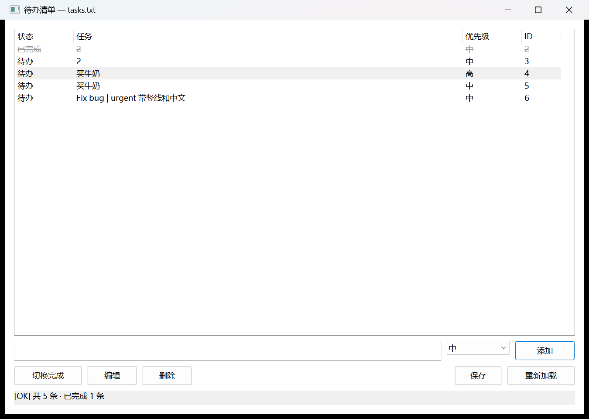
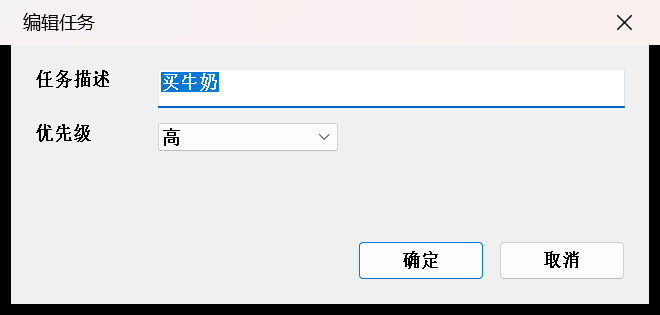

# C++ To-Do List（重构版）

[repo_todo](../repo_todo) 的修好 + 分层 + 可测试版本。用来给"会刷力扣但没有项目经验"的同学做第一个真正的工程练习。

**两个前端，一个内核**：控制台版（`todo_app`）和 Win32 图形界面版（`todo_gui`）共用同一套 `todo_core`，业务规则和文件格式一份代码都没复制。加界面时核心层一行没改——这就是分层的收益。

- **想动手**：先看 [ISSUES.md](ISSUES.md)，那是一份带复现步骤的 bug 清单，请在**旧版**上一条条跑出来。
- **想理解为什么这么改**：看 [REFACTOR_NOTES.md](REFACTOR_NOTES.md)。




## 构建

需要 CMake 3.16+ 和一个 C++17 编译器。

```bash
cmake -S . -B build
cmake --build build
```

Windows 上如果默认生成的是 Visual Studio 工程：

```bash
cmake -S . -B build
cmake --build build --config Debug
```

三个目标：

| 目标 | 是什么 |
|---|---|
| `todo_core` | 静态库：数据、文件、规则、显示文字（**两个前端共用**） |
| `todo_app` | 控制台版 |
| `todo_gui` | Win32 图形界面版（Windows 才有） |

在 Visual Studio 里：**打开文件夹**（它会自动识别 CMake），在启动项里把 `todo_gui.exe` 设为启动目标，F5。

## 运行

```bash
# Linux / macOS / MinGW —— 控制台版
./build/todo_app

# Visual Studio 生成器
./build/Debug/todo_app.exe

# 图形界面（Windows）
./build/Debug/todo_gui.exe
```

数据存在**当前工作目录**的 `tasks.txt`。所以从 `build/` 里跑和从项目根跑，看到的是两份不同的数据——这是最容易让人困惑的一点，改之前先确认自己在哪个目录。（VS 里调试时，两个目标的工作目录都已被 `CMakeLists.txt` 固定成项目根目录，不会踩这个坑。）

## 测试

```bash
cd build
ctest -C Debug --output-on-failure
```

或者直接跑测试程序看逐项输出：

```bash
./build/Debug/todo_tests.exe
```

预期看到：

```
- escaping round-trip
- file round-trip keeps a description containing '|'
- ids survive reload (the original renumbered them)
- presenter turns data into display text
...
65 checks, 0 failure(s)
```

最后那个 `presenter turns data into display text` 是图形界面带出来的：把"界面上该显示什么字"抽成了纯字符串函数，于是连界面文案都能被 `ctest` 覆盖，窗口代码只剩"贴到哪个控件上"。

## 目录

```
todo_v2/
├── CMakeLists.txt
├── README.md              ← 你在这里
├── ISSUES.md              ← 旧版的 7 个问题 + 复现步骤（练习单）
├── REFACTOR_NOTES.md      ← 设计决定、踩坑记录、七天计划
├── include/
│   ├── task.h             ← 纯数据
│   ├── task_store.h       ← 文件格式与转义
│   ├── task_manager.h     ← 业务规则，返回 Result
│   ├── presenter.h        ← 数据和界面之间的"翻译"（纯字符串）
│   └── console_ui.h       ← 控制台的所有输入输出
├── src/
│   ├── main.cpp           ← 装配，10 行
│   ├── task.cpp
│   ├── task_store.cpp
│   ├── task_manager.cpp
│   ├── presenter.cpp
│   └── console_ui.cpp
├── gui/
│   └── win32_ui.cpp       ← Win32 图形界面（1259 行，注释占了大半）
├── docs/
│   └── screenshot-*.png   ← README 里用的截图
└── tests/
    └── test_todo.cpp      ← 无框架，只有 EXPECT（65 个断言）
```

## 数据格式

每行一条任务，`|` 分隔四个字段：

```
<id>|<描述>|<优先级>|<状态>
```

- 描述里的 `|`、`\`、换行会被转义成 `\|`、`\\`、`\n`
- 优先级：`High` / `Medium` / `Low`（大小写不敏感，认不出就当 `Medium`）
- 状态：`0` 未完成，`1` 已完成

```
1|Study C++ classes|High|0
2|Fix bug \| urgent|Medium|1
```

**和旧版的区别**：多了 ID 这一列。这就是"ID 不再跳号"的全部秘密。

**编码**：文件是 **UTF-8**。旧的控制台版按系统代码页（简体中文 Windows 上是 GBK）写盘，所以图形界面第一次启动时会检查一次：文件不是合法 UTF-8 就**先备份成 `tasks.txt.bak`，再转成 UTF-8**。这个迁移只发生一次，之后两个前端读写的是同一份 UTF-8 数据。

## 图形界面



| 操作 | 怎么做 |
|---|---|
| 添加 | 输入框里打字，按回车或点「添加」 |
| 切换完成 | 选中一行，点「切换完成」或**双击**该行 |
| 编辑 | 选中一行 → 「编辑」（弹窗里的优先级默认是这条任务原本的值） |
| 删除 | 选中一行 → 「删除」或按 `Del` 键（会确认） |
| 保存 / 重新加载 | 「保存」按钮、`Ctrl+S` / 「重新加载」按钮、`F5` |
| 搜索？排序？ | **故意没做**，留给你（见 REFACTOR_NOTES 的"故意没做的事"） |

几个实现上的点，都写在 [gui/win32_ui.cpp](gui/win32_ui.cpp) 的注释里：

- **没有任何第三方库、没有 `.rc` 资源文件**，窗口和控件全部 `CreateWindowExW` 建出来；公共控件 v6 的外观靠一行 `#pragma comment(linker, "/manifestdependency:...")`
- 撤销/重做、DPI、编码转换都只在**界面层**做，核心层仍然是纯 `std::string`
- 已完成的任务会画成**灰色 + 删除线**（`NM_CUSTOMDRAW`），这是 ListView 唯一的"自定义绘制"入口
- 未保存时标题栏会出现 `*`，关窗会问你要不要保存

## 菜单（控制台版）

```
1. Add task
2. View all tasks
3. Mark task complete
4. Mark task incomplete
5. Edit task
6. Delete task
7. Save tasks
8. Load tasks
9. Save and quit
```

（旧版 README 写的是 8 项，和程序实际不符——这里已经对齐了。）
